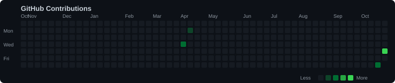

# Tushar Vijay Paidlewar

**Finance · Credit Risk · Data Analytics**

I explore how financial data can explain risk, evaluate businesses, and support better financial decisions.

I'm pursuing an MBA in Finance & Data Science and AI at Woxsen University, Hyderabad. I use this profile to document practical projects at the intersection of finance, analytics, and technology.

---

## Profile

  

  

## GitHub Contributions

  

---

## Areas of Interest

- Credit Risk Modelling & Credit Scoring
- Financial Statement Analysis & Valuation
- Investment & Mutual Fund Analytics
- Banking, Fintech & Financial Markets

## Featured Project

### [Credit Risk Scorecard](https://github.com/arnold0010/credit-risk-scorecard)

An end-to-end credit risk modelling project exploring borrower default prediction, credit scoring, model explainability, and risk-based lending decisions.

| Metric | Result |
|---|---:|
| Dataset | 150,000 borrowers |
| Scorecard AUC | 0.858 |
| XGBoost AUC | 0.867 |
| Simulated bad-loan rate | 6.7% → 3.4% at the evaluated approval cutoff |

**Tools:** Python · XGBoost · SHAP · Streamlit

## Background

- B.Tech in Electrical Engineering
- Patent filing: EV Range Optimization System

## Connect

[LinkedIn](https://www.linkedin.com/in/tusharpaidlewar) · [GitHub Repositories](https://github.com/arnold0010?tab=repositories)
