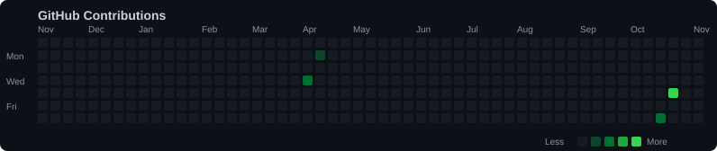

<!--
  Tushar Vijay Paidlewar — GitHub Profile README
  Finance × Data Science | Terminal-Inspired Design
  Auto-updated contribution heatmap via GitHub Actions
-->

<!-- ═══════════════ HEADER ═══════════════ -->

<div align="center">
  
</div>

<br>

<!-- ═══════════════ CONTRIBUTION HEATMAP ═══════════════ -->

<div align="center">
  
</div>

<br>

<!-- ═══════════════ ASCII PORTRAIT + INFO CARD ═══════════════ -->

<table align="center">
  <tr>
    <td width="35%" align="center" valign="middle">
      
    </td>
    <td width="65%" align="center" valign="middle">
      
    </td>
  </tr>
</table>

<br>

<p align="center">
  
</p>

<!-- ═══════════════ ABOUT ═══════════════ -->

### `tushar@finance ~ $ whoami`

MBA candidate specializing in **Finance** and **Data Science & AI** at **Woxsen University, Hyderabad**, with a B.Tech foundation in Electrical Engineering.

I explore how financial data can explain risk, evaluate businesses, and support better financial decisions — applying machine learning where it genuinely improves decision quality.

Currently focused on:
- **Credit risk modelling** — probability of default estimation, scorecard development, and cutoff optimization.
- **Financial statement analysis & valuation** — ratio-driven assessment and investment research.
- **Python-based financial analytics** — reproducible workflows from raw data to business interpretation.

<br>

<p align="center">
  
</p>

<!-- ═══════════════ FEATURED PROJECTS ═══════════════ -->

### `tushar@finance ~ $ ls -la ./projects/`

<table>
  <thead>
    <tr>
      <th align="left" width="300">Project</th>
      <th align="left" width="540">Description</th>
    </tr>
  </thead>
  <tbody>
    <tr>
      <td>
        <a href="https://github.com/arnold0010/credit-risk-scorecard">
          <strong>📊 Credit Risk Scorecard</strong>
        </a>
        <br><br>
        <a href="https://credit-risk-scorecard.streamlit.app">
          
        </a>
        
      </td>
      <td>
        End-to-end <strong>Probability of Default</strong> pipeline for consumer lending risk assessment.
        <br><br>
        <strong>Problem:</strong> Determine which loan applicants are likely to default, and set a data-driven approval threshold that balances acceptance rates against expected losses.
        <br><br>
        <strong>Approach:</strong>
        <ul>
          <li>Feature engineering via <strong>Weight of Evidence (WoE)</strong> transformation and <strong>Information Value (IV)</strong> feature selection</li>
          <li><strong>Logistic Regression</strong> trained on WoE-transformed features for scorecard</li>
          <li><strong>XGBoost</strong> benchmark model with <strong>SHAP</strong> explainability</li>
          <li>Log-odds scaled to a traditional <strong>credit scorecard</strong> with optimized approval cutoff</li>
        </ul>
        <strong>Key Results:</strong>
        <table>
          <tr><td>Dataset</td><td align="right"><strong>150,000</strong> borrowers</td></tr>
          <tr><td>Scorecard AUC</td><td align="right"><strong>0.858</strong></td></tr>
          <tr><td>XGBoost AUC</td><td align="right"><strong>0.867</strong></td></tr>
          <tr><td>Simulated bad-loan rate</td><td align="right">6.7% → <strong>3.4%</strong> at optimal cutoff</td></tr>
        </table>
        <br>
        <sub><strong>Stack:</strong> Python · XGBoost · SHAP · scikit-learn · Streamlit</sub>
      </td>
    </tr>
  </tbody>
</table>

> [!NOTE]
> **More projects in development.** Equity research, IPO analysis, and financial modelling work is in progress and will be published here when complete.

<br>

<p align="center">
  
</p>

<!-- ═══════════════ TOOLKIT ═══════════════ -->

### `tushar@finance ~ $ cat /etc/toolkit.conf`

```ini
# ── Analytical Methods ──────────────────────────────────────────────
credit_risk        = WoE/IV binning, PD modelling, scorecard scaling, cutoff optimization
financial_analysis = ratio analysis, financial statement analysis, DCF fundamentals
machine_learning   = logistic regression, XGBoost, SHAP explainability
statistics         = ROC/AUC, Gini coefficient, KS statistic, hypothesis testing

# ── Languages & Tools ──────────────────────────────────────────────
languages          = Python, SQL
analytics          = pandas, numpy, scikit-learn, statsmodels
visualization      = matplotlib, seaborn, plotly, Streamlit, Power BI
platforms          = Excel, Jupyter, Git, GitHub Actions
```

<br>

<p align="center">
  
</p>

<!-- ═══════════════ BACKGROUND ═══════════════ -->

### `tushar@finance ~ $ cat ./background.log`

- 🎓 **MBA** — Finance & Data Science / AI · Woxsen University, Hyderabad
- 🎓 **B.Tech** — Electrical Engineering
- 📄 **Patent Filing** — EV Range Optimization System
- 💼 Marketing and finance internship experience

<br>

<p align="center">
  
</p>

<!-- ═══════════════ CONNECT ═══════════════ -->

### `tushar@finance ~ $ ./connect.sh`

<p>
  <a href="https://www.linkedin.com/in/tusharpaidlewar">
    
  </a>
  &nbsp;
  <a href="mailto:paidlewartushar1234@gmail.com">
    
  </a>
  &nbsp;
  <a href="https://github.com/arnold0010?tab=repositories">
    
  </a>
</p>

<br>

---

<div align="center">
  <sub>
    Contribution heatmap refreshes daily via
    <a href=".github/workflows/update-profile-art.yml">GitHub Actions</a>
    &nbsp;·&nbsp;
    Terminal aesthetic &nbsp;·&nbsp;
    Built with Python &amp; custom SVGs
  </sub>
</div>
